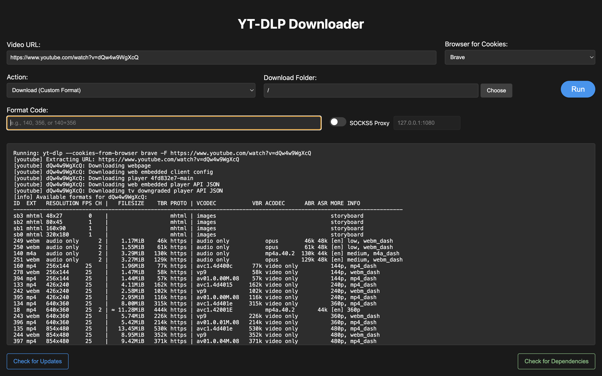

<p align="center">
  
</p>

# YT Downloader Electron

This is a modern, user-friendly desktop application for downloading videos from YouTube and other supported platforms. It uses yt-dlp for download, and FFmpeg to change the format or add subtitles.

It has two interfaces that you can switch between at any time:

- **Classic**: a form with a URL box, an action list and a Run button. Works offline and needs no account or API key.
- **AI (optional)**: describe what you want in plain language, for example *"Download this video as MP3: https://..."*, and an AI assistant carries it out with yt-dlp and FFmpeg.



## Features

- **Classic / AI mode switch**: use the form, or just describe what you want (see [AI mode](#ai-mode-optional) below)
- Download videos in various formats and qualities
- Smart subtitle downloading with language selection
- Hardcode subtitles into video with customizable positioning (Bottom or Top) using hardware acceleration (H.264 / HEVC)
- Automatically extracts and embeds YouTube thumbnails natively into MP4 video containers
- Safely cancel any ongoing downloads or encoding processes
- Built-in process concurrency guards and command injection task protections
- Browser cookie support (Brave, Chrome, Firefox, Safari)
- Custom download folder selection
- Real-time download progress
- Format selection with detailed format list
- MP4 re-encoding with H.264/AAC codecs for maximum compatibility
- SOCKS5 Proxy support (default listening address `127.0.0.1:1080`, with manual custom override)

> [!IMPORTANT]
> **yt-dlp and FFmpeg Are Not Bundled**

**This app does NOT bundle `yt-dlp` or `FFmpeg` inside the installer.**  
You must have both `yt-dlp` and `FFmpeg` installed on your system for the app to work.

- **On macOS:**  
  The app checks dependencies globally (including MacPorts, Homebrew, and custom PATH locations). Use the app's **"Check for Dependencies"** button. If dependencies are missing, the app can install them via Homebrew or you can install via MacPorts (`sudo port install yt-dlp ffmpeg`).
- **On Linux:**  
  Please install `yt-dlp` and `FFmpeg` using your package manager before use (see below).
- **On Windows:**  
  Please install [yt-dlp](https://github.com/yt-dlp/yt-dlp#installation) and [FFmpeg](https://ffmpeg.org/download.html) manually and make sure they are available in your PATH.

## Installation

### Method 1: Direct Download (Recommended for Users)

1. Download the latest release from the [Releases](https://github.com/Shawshank01/yt-downloader-electron/releases) page.
2. Extract the downloaded file and run the installer for your OS:
    - **macOS:** `.dmg`
    - **Linux:** `.AppImage` or `.deb`
    - **Windows:** `.exe` installer
3. **First Run:**
    - On **macOS**, drag `YT Downloader.app` to `/Applications`. If macOS shows *“YT Downloader.app is damaged and can’t be opened. You should move it to the Trash”* (Gatekeeper quarantine for unsigned apps), click Cancel, open Terminal and run:

      ```bash
      xattr -cr /Applications/"YT Downloader.app"
      ```

      Then open the app and click **"Check for Dependencies"** (bottom-right corner). If dependencies are missing, you can install them via MacPorts (`sudo port install yt-dlp ffmpeg`) or Homebrew (`brew install yt-dlp ffmpeg`).
    - On **Linux/Windows**, you must install `yt-dlp` and `FFmpeg` yourself if not already present (see troubleshooting below).

### Method 2: From Source (For Developers)

1. Clone the repository:

   ```bash
   git clone https://github.com/Shawshank01/yt-downloader-electron.git
   cd yt-downloader-electron
   ```

2. Install dependencies:

   ```bash
   pnpm install
   ```

3. Start the application:

   ```bash
   pnpm start
   ```

#### Building Distributables

To build the application for your platform:

```bash
pnpm run build
```

This will create a distributable package in the `dist` directory.

## AI mode (optional)

Click **AI** in the top-right corner to switch from the form to a chat. Your choice is remembered. Classic mode keeps working exactly as before, so you can always switch back, and AI mode never replaces it.

### What you can ask for

- *"Download this video in 720p: https://..."*
- *"Get the audio of this video as an MP3"*
- *"What subtitle languages does this video have?"* then *"Hardcode the English ones at the top"*
- *"Download it, then re-encode it to a compatible MP4"* (multi-step requests work)
- *"Show me the files in my download folder"* / *"Delete the leftover subtitle files"*

The assistant can use these tools: video info, list formats, download video, download audio (MP3, M4A, Opus, FLAC, WAV), download thumbnail, list and download subtitles, hardsub, re-encode to MP4, list and delete files in the download folder, and cancel the running task.

> [!NOTE]
> The assistant can only do what those tools allow. For example it cannot trim a video yet; it will say so and suggest an `ffmpeg` command instead. Everything it does uses the same download folder, browser-cookie and proxy settings as Classic mode.

### Setting it up

1. Click **AI**, then **AI Settings**.
2. Choose a provider, check the model name, paste your API key (if the provider needs one) and click **Save key**.
3. Click **Test connection**, then **Save**.
4. Choose a download folder (the same field as in Classic mode) and start chatting.

| Provider | Needs | Notes |
|---|---|---|
| **Google Gemini** (default, model `gemini-3.8-flash`) | Free API key from [Google AI Studio](https://aistudio.google.com/apikey) | Free tier can be busy (HTTP 503) or rate limited; the app retries automatically. Your messages go to Google. |
| **xAI (Grok)** (model `grok-4.7`) | API key from the [xAI console](https://console.x.ai) | Uses the OpenAI-compatible endpoint `https://api.x.ai/v1`. |
| **Ollama (local)** | [Ollama](https://ollama.com) running locally and a model with tool support (for example `qwen3` or `llama3.1`) | Everything stays on your computer. Small models are less reliable. |
| **OpenAI-compatible** | Server URL, model name, usually an API key | Works with OpenAI, OpenRouter, Groq, LM Studio and similar. |

Other settings:

- **Response speed** (Gemini only): *Fast* (default) is quick and enough for downloads; *Balanced* and *Thorough* think longer and are much slower.
- **Ask me before running**: *Risky actions only* (default: re-encode, hardsub, deleting files, downloading playlists), *Every action*, or *Never*. When a confirmation is needed you get an Allow / Deny dialog; Deny is the default button.

### Privacy and security

- **What is sent to the AI provider:** your messages, the assistant's replies, and tool results (video titles, file names, folder listings). It is sent again with every request while a chat is open. Check your provider's data terms; some free tiers may use data to improve their products. Choose Ollama if everything must stay on your computer.
- **API keys** are stored encrypted with Electron's `safeStorage` (macOS Keychain, Windows DPAPI, Linux keyring) in `ai-keys.json` inside the app's data folder. They never reach the interface part of the app. If your system has no secure storage (some Linux setups), keys are kept in memory for the current session only and you are told so.
- **Conversations are not saved.** They live in memory only. **New chat** or closing the app discards them.
- **The assistant cannot run arbitrary commands.** It picks from a fixed set of tools, and the app validates every value (URLs must be `http(s)`, file names cannot contain paths, and so on) and builds the `yt-dlp` / `ffmpeg` arguments itself. Files can only be written inside your chosen download folder. Browser cookies and proxy settings are never changed by the assistant.
- **Treat website text as untrusted.** Video titles and descriptions are passed to the model as data; the assistant is instructed never to follow instructions found in them. Replies are rendered as formatted text, never as HTML, and links open in your browser only for `http(s)` URLs.
- The terminal output (`pnpm start`) prints diagnostic lines starting with `[ai]` (timing, token counts, errors). They never contain your key, your messages or the replies. Nothing is written to a log file.

## Usage

1. **Basic Video Download**
   - Enter the video URL
   - Select "Download Video (Best Quality)"
   - Choose your browser for cookies (if needed)
   - Select a download folder
   - Click "Run"

2. **Format Selection**
   - Enter the video URL
   - Select "List Formats" to see available formats
   - Choose "Choose Format" and enter the format code
   - Click "Run"

3. **Subtitle Download**
   - Enter the video URL
   - Select "Download Subtitles"
   - Click "Run"
   - A dialog will appear listing available subtitle languages (auto-generated translated subtitles are filtered out to prevent rate-limiting)
   - Select your preferred language to download

4. **MP4 Re-encoding (H.264/AAC)**
   - Enter the video URL
   - Select "Download & Re-encode as MP4 (H.264/AAC)"
   - Click "Run"
   - The video will be downloaded and then re-encoded using FFmpeg with:
     - Video: H.264 (libx264) with CRF 18 and veryslow preset for maximum quality
     - Audio: AAC (aac_at preferred with CVBR 128k, falls back to libfdk_aac, then aac if not available)
     - Container: MP4 with proper AVC1 tag

5. **Download with Hardsub**
   - Enter the video URL
   - Select "Download & Add Hardsub"
   - Choose your preferred codec (H.264 or HEVC)
   - Choose your preferred subtitle position (**Bottom** or **Top**)
   - Click "Run"
   - Select the subtitle language from the popup dialog
   - The app will securely download the best video quality and automatically hardcode the subtitles using macOS hardware acceleration (`videotoolbox`) or universal encoders on Windows and Linux (`libx264`/`libx265`).
   - *Note: Subtitle fonts adapt automatically to your operating system (PingFang SC/Songti SC on macOS, Microsoft YaHei/Arial on Windows, DejaVu Sans on Linux).*

6. **SOCKS5 Proxy Mode**
   - Toggle the **SOCKS5 Proxy** switch to route all `yt-dlp` requests (including subtitle metadata fetching and media downloads) through a proxy server.
   - The default address is set to `127.0.0.1:1080` (e.g. for SSH tunnels or local proxy applications).
   - If your proxy is running on a different port or host, you can edit the address manually before running the action.

**Cancelling Actions:**  
During any long-running download or encoding action, a "Cancel Action" button will appear. Clicking it will cleanly abort the current process (`yt-dlp` or `FFmpeg`) and clean up any partial files.

## Updating

The app includes a built-in update checker:

1. Click the "Check for Updates" button to:
   - Check for a new version of the app
   - See your current version
2. If a new version is available, you will be prompted to open the [GitHub Releases](https://github.com/Shawshank01/yt-downloader-electron/releases/latest) page to download the latest installer for your platform (macOS, Windows, or Linux).
3. If you are already on the latest version, the app will let you know that you are up to date.

**Update button is only supported when running the packaged app** (from `.dmg`, `.exe`, or `.AppImage`/`.deb`). If you run the app in development mode (using `start.command` or `pnpm start`), update may not be available.

> [!NOTE]
>
> - The app cannot update `yt-dlp` or `FFmpeg` automatically on Windows or Linux—you must update them yourself (see Troubleshooting below).
> - On macOS, the app checks dependencies globally across MacPorts, Homebrew, and your PATH.

## Troubleshooting

1. **Missing Dependencies**
   - Click **"Check for Dependencies"** to view install status, binary path (`which`/`where`), and version.
   - On **macOS**, you can choose one-click install via Homebrew when prompted, or install via MacPorts.
   - On **Linux/Windows**, install manually (no one-click installer in app).
   - If manual installation is needed:
     - **macOS (MacPorts):**  

       ```bash
       sudo port install yt-dlp ffmpeg
       ```

     - **macOS (Homebrew):**  

       ```bash
       brew install yt-dlp ffmpeg
       ```

     - **Linux (Ubuntu/Debian):**  

       ```bash
       sudo apt install yt-dlp ffmpeg
       ```

     - **Windows:**  
       - Download [yt-dlp](https://github.com/yt-dlp/yt-dlp#installation) and [FFmpeg](https://ffmpeg.org/download.html)
       - Add them to your system PATH

2. **Update Issues**
   - If updates fail, try updating `yt-dlp` and `FFmpeg` manually (see above).

3. **Browser Cookie Issues**
   - Make sure you're logged into YouTube in your selected browser
   - Try a different browser if issues persist
   - On **macOS**, when reading browser cookies, macOS may block data access until permitted. Follow the in-app prompt or navigate to **System Settings > Privacy & Security > Files & Folders**, enable access for `YT Downloader.app` under the corresponding browser, and restart the app.

4. **AI Mode Issues**
   - **"Gemini is having problems (HTTP 503)"**: Google's servers are overloaded, which happens on the free tier. The app already retries three times. Try again in a minute, switch provider, or use Classic mode.
   - **"Rate limit or quota reached" (HTTP 429)**: you used up the free quota. Wait, switch provider, or use Classic mode.
   - **"rejected the API key"** or **"could not find model"**: open **AI Settings**, re-paste the key, check the model name, and use **Test connection**.
   - **Slow answers**: keep **Response speed** on *Fast*. With Ollama, the first answer after starting a model is slower.
   - **A download fails with a cookie error**: AI mode uses the browser selected in the *Browser for Cookies* box, exactly like Classic mode. Choose the right browser (or *No cookies*) and ask again.

5. **start.command Issues (macOS)**
   - If you get a security warning, right-click the file and select "Open"
   - Make sure the file has execute permissions:

     ```bash
     chmod +x start.command
     ```

## Development

```bash
pnpm install
pnpm start        # run the app
pnpm run lint     # ESLint over src/ and test/
pnpm test         # automated tests (Node's built-in test runner, no extra dependencies)
```

The tests (in `test/`) need no network access and no API key: they use mock HTTP responses and scripted fake models. They cover input validation, the tool layer, the AI providers, the agent loop, key storage, settings, the Markdown renderer and static checks of the interface wiring. They do **not** open the app window, so after changing the interface run `pnpm start` and try it by hand. The `test/` folder is excluded from the packaged installer.

### Project layout

```
src/
  main.js              Electron main process: window, settings, thin IPC handlers
  preload.cjs          Safe bridge between the window and the main process (window.electronAPI)
  renderer.js          Classic interface
  ai-ui.js             AI mode interface: mode switch, chat, settings dialog, confirmation dialog
  markdown.js          Small safe Markdown renderer for assistant replies
  index.html, styles.css
  core/                Electron-free yt-dlp / ffmpeg operations shared by Classic and AI mode
    tools.js             runYtDlp, listSubtitles, reEncodeToMp4, downloadWithHardsub, ...
    task-manager.js      one running task at a time, cancellation
    ffmpeg.js, media-files.js, log-filter.js
  llm/                 AI mode backend (also Electron-free)
    agent.js             the loop: model call -> tool calls -> results -> answer
    tool-registry.js     the 12 tools the model may call (schemas, validation, argument building)
    validate.js          validation of every model-supplied value
    chat-service.js      settings, conversation, confirmations, cancel, error handling
    key-store.js         encrypted API key storage
    prompt.js            system prompt
    providers/           gemini.js, ollama.js, openai-compatible.js (also used for xAI), http.js (retries)
test/                  automated tests
docs/PROJECT-STATUS.md  status, decisions and roadmap (good starting point for new contributors)
```

See [`docs/PROJECT-STATUS.md`](docs/PROJECT-STATUS.md) for the architecture, design decisions, what has and has not been verified, and the roadmap.

## Contributing

1. Fork the repository
2. Create your feature branch
3. Make your changes and run `pnpm run lint` and `pnpm test`
4. Commit your changes
5. Push to the branch
6. Create a Pull Request

## Acknowledgments

- [yt-dlp](https://github.com/yt-dlp/yt-dlp) - The core download engine
- [FFmpeg](https://ffmpeg.org/) - For video processing
- [Electron](https://www.electronjs.org/) - For the desktop application framework
- [Google Gemini](https://ai.google.dev/), [xAI](https://x.ai/api) and [Ollama](https://ollama.com) - Optional AI providers for AI mode
