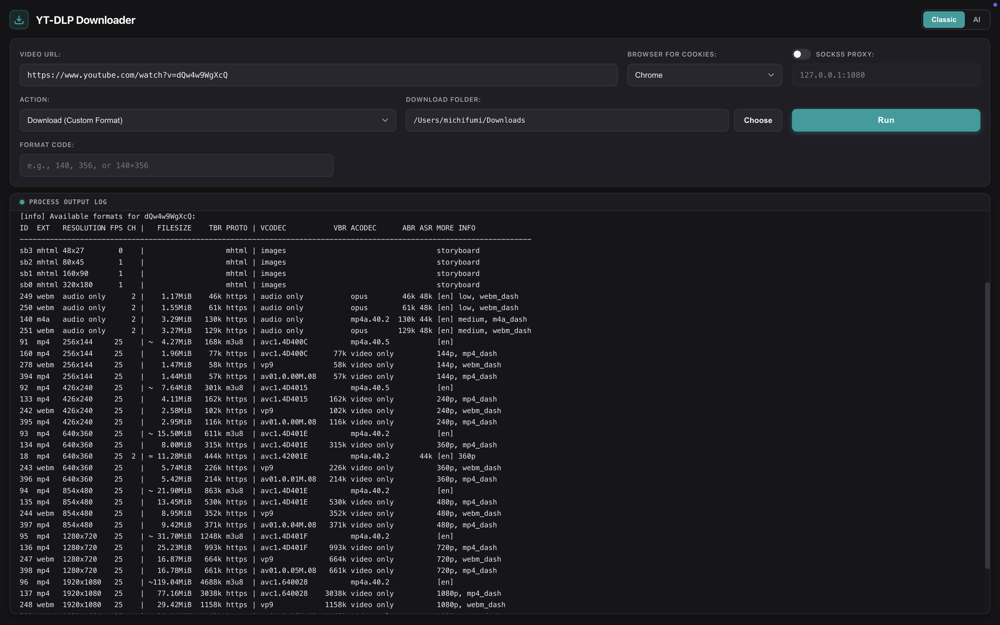
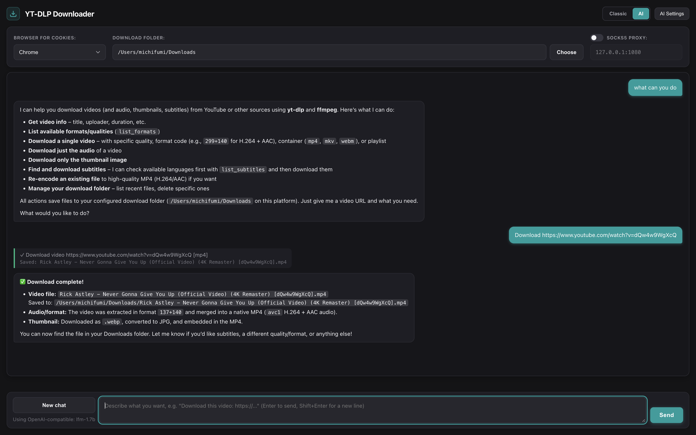

<p align="center">
  
</p>

# YT Downloader

This is a user-friendly desktop application with **AI Assistance**. It uses yt-dlp for downloading videos from YouTube, X (Twitter), Instagram and many other platforms, and FFmpeg for checking the format, re-encoding and adding subtitles.

It has two interfaces that you can switch between at any time:

- **Classic**: A form with a URL box, an action list and a Run button. Needs no account or API key.
- **AI Mode (🆕)**: Describe what you want in plain language, for example *"Download this video: https://..."*, powered by an autonomous **Agent Harness** that safely orchestrates yt-dlp and FFmpeg under deterministic engineering guardrails.


Classic UI


AI Mode UI

## Features

- **Classic / AI mode switch**: Use the form, or just describe what you want (see [AI mode](#ai-mode-usage) below)
- Download videos in various formats and qualities
- Real-time download progress info
- Custom download folder selection
- Browser cookie support (Brave, Chrome, Firefox, Safari)
- Format selection with detailed format list
- Automatically extracts and embeds thumbnails natively into MP4 video containers
- MP4 re-encoding with H.264/AAC codecs for maximum compatibility
- Smart subtitle downloading with language selection
- Hardcode subtitles into video with customizable positioning (Bottom or Top) using hardware acceleration on macOS (H.264 / HEVC)
- Safely cancel any ongoing downloads, encoding processes or AI conversation
- Built-in process concurrency guards and command injection task protections
- SOCKS5 Proxy support (default listening address `127.0.0.1:1080`, with manual custom override)

## Installation

### Method 1: Homebrew (macOS)

You can install and update the app using Homebrew:

```bash
brew install --cask Shawshank01/tap/yt-downloader
```

To update to new versions in the future:

```bash
git -C "$(brew --repository Shawshank01/tap)" pull
brew upgrade --cask yt-downloader
```

### Method 2: Direct Download

1. Download the latest release from the [Releases](https://github.com/Shawshank01/yt-downloader-electron/releases) page.
2. Run the installer or image for your OS:
    - **Linux:** `.AppImage`
    - **macOS:** `.dmg` (download `mac-arm64` if you are using an M-series Mac)
    - **Windows:** `.exe` installer (download `win-x64` if you're not sure which to choose)
3. **First Run:**
    - On **macOS**, drag `YT Downloader.app` to `/Applications`, then open Terminal and run:

      ```bash
      xattr -cr /Applications/"YT Downloader.app"
      ```

### Method 3: From Source (For Developers)

1. Clone the repository:

   ```bash
   git clone https://github.com/Shawshank01/yt-downloader-electron.git
   cd yt-downloader-electron
   ```

2. Install dependencies:

   ```bash
   pnpm install
   ```

3. Start the application:

   ```bash
   pnpm start
   ```

   *(On macOS, you can also double-click `start.command` in the project root to install dependencies and launch the app automatically.)*

#### Building Distributables

To build the application for your platform:

```bash
pnpm run build
```

This will create a distributable package in the `dist` directory.

## AI mode Usage

Click **AI** in the top-right corner to switch from the form to a chat. Use natural language to perform a variety of functions.

### What you can ask for

- *"Download this video: https://..."*
- *"Download this video in 720p: https://..."*
- *"Get the audio of this video as an MP3"*
- *"What subtitle languages does this video have?"* then *"Hardcode the English ones at the top"*
- *"Download it, then re-encode it to a compatible MP4"* (multi-step requests work)
- *"Show me the files in my download folder"* / *"Delete the leftover subtitle files"*

The assistant can use these tools: online video info, local media info (inspecting codecs/duration of existing files), list formats, download video, download audio (MP3, M4A, Opus, FLAC, WAV), download thumbnail, list and download subtitles, hardsub, re-encode to MP4, and list and delete files in the download folder.

> [!NOTE]
> The assistant can only do what those tools allow. For example it cannot trim a video yet; it will say so and suggest an `ffmpeg` command instead. Everything it does uses the same download folder, browser-cookie and proxy settings as Classic mode.

### Built with Harness Engineering

Rather than relying on fragile prompt engineering or bloated frameworks, the AI subsystem is built from the ground up using **Harness Engineering** principles (`Agent = Model + Harness`). The harness serves as a deterministic, defensive control plane and operating system around non-deterministic LLMs:

- **State Machine Agent Loop**: Coordinates model calls, multi-turn tool execution, output trimming, and strict step budgets with clean cancellation semantics (`src/llm/agent.js`).
- **Zero Shell Access & Strict Typed Tools**: The model is never given a raw shell. Every tool call validates parameters against strict schemas, building safe argument vectors directly (`src/llm/validate.js`).
- **Self-Healing Context & Parameter Recovery**: The harness detects and repairs dropped parameters across multi-turn sessions (e.g. automatically recovering user-typed video URLs from earlier turns when follow-up requests say *"download 1080p as mp4"*).
- **Prompt Injection Defense & URL Provenance**: Untrusted web data (video titles, descriptions, subtitles) is strictly quarantined from execution; URLs not typed by the user are flagged as foreign and require explicit user confirmation (`src/llm/provenance.js`).
- **Native Format Intelligence**: Eliminates unnecessary re-encoding by dynamically injecting stream-prioritisation flags (`--format-sort res,vcodec:h264,ext:mp4:m4a`), downloading and remuxing native MP4 streams directly in seconds.
- **Zero Framework Bloat**: Pure ES modules without LangChain or LlamaIndex wrappers. The core engine and harness are completely decoupled from Electron and covered by 165 automated tests.

### Setting it up

1. Click **AI**, then **AI Settings**.
2. Choose a provider, check the model name, paste your API key (if the provider needs one) and click **Save key**.
3. Click **Test connection**, then **Save**.
4. Choose a download folder (the same field as in Classic mode) and start chatting.

| Provider | Needs | Notes |
| --- | --- | --- |
| **Google Gemini** (default, model `gemini-3.5-flash-lite`) | Free API key from [Google AI Studio](https://aistudio.google.com/apikey) | Free tier can be busy (HTTP 503) or rate limited, the app retries automatically. Your messages go to Google. |
| **xAI Grok** (model `grok-4.3`) | API key from the [xAI console](https://console.x.ai) | Uses xAI's Responses API at `https://api.x.ai/v1/responses`. Your messages go to Musk. |
| **Ollama (local)** | [Ollama](https://ollama.com) running with a tool-capable model, for example `LFM3:1.7b`, `Qwen3`. | Everything stays on your computer if you run a local model. Small models are faster but less reliable. |
| **OpenAI-compatible** | Server URL, model name, usually an API key | Works with llama.cpp, OpenAI, OpenRouter, Groq, LM Studio and similar. |

Other settings:

- **Reasoning effort**: *Fast* (default) is quick and enough for downloads; *Balanced* and *Thorough* think longer and are slower. A similar setting applies to xAI (*None*, *Low*, *Medium*, *High*, *Extra thorough*).
- **Ask me before running**: *Risky actions only* (default: re-encode, hardsub, deleting files, downloading playlists), *Every action*, or *Never*. When a confirmation is needed you get an Allow / Deny dialog; Deny is the default button.

### Privacy and security

- **What is sent to the AI provider:** your messages, the assistant's replies, and tool results (video titles, file names, folder listings). It is sent again with every request while a chat is open. Check your provider's data terms; some free tiers may use data to improve their products. Choose Ollama if everything must stay on your computer.
- **API keys** are stored encrypted with Electron's `safeStorage` (macOS Keychain, Windows DPAPI, Linux keyring) in `ai-keys.json` inside the app's data folder. They never reach the interface part of the app. If your system has no secure storage (some Linux setups), keys are kept in memory for the current session only and you are told so.
- **Conversations are not saved.** They live in memory only. **New chat** or closing the app discards them.
- **The assistant cannot run arbitrary commands.** It picks from a fixed set of tools, and the app validates every value (URLs must be `http(s)`, file names cannot contain paths, and so on) and builds the `yt-dlp` / `ffmpeg` arguments itself. Files can only be written inside your chosen download folder. Browser cookies and proxy settings are never changed by the assistant.
- **Treat website text as untrusted.** Video titles and descriptions are passed to the model as data; the assistant is instructed never to follow instructions found in them. Replies are rendered as formatted text, never as HTML, and links open in your browser only for `http(s)` URLs.
- The terminal output (`pn start`) prints diagnostic lines starting with `[ai]` (timing, token counts, errors). They never contain your key, your messages or the replies. Nothing is written to a log file.

## Classic Mode Usage

1. **Basic Video Download**
   - Enter the video URL
   - Select "Download Video (Best Quality)"
   - Choose your browser for cookies (if needed)
   - Select a download folder
   - Click "Run"

2. **Format Selection**
   - Enter the video URL
   - Select "List Formats" to see available formats
   - Choose "Download (Custom Format)" and enter the format code
   - Click "Run"

3. **Subtitle Download**
   - Enter the video URL
   - Select "Download Subtitles"
   - Click "Run"
   - A dialog will appear listing available subtitle languages (auto-generated translated subtitles are filtered out to prevent rate-limiting)
   - Select your preferred language to download

4. **MP4 Re-encoding (H.264/AAC)**
   - Enter the video URL
   - Select "Download & Re-encode as high quality MP4 (H.264/AAC)"
   - Click "Run"
   - The video will be downloaded and then re-encoded using FFmpeg with:
     - Video: H.264 (libx264) with CRF 22 and veryslow preset for high quality
     - Audio: AAC (aac_at preferred with CVBR 128k, falls back to libfdk_aac, then aac if not available)
     - Container: MP4 with proper AVC1 tag

5. **Download with Hardsub**
   - Enter the video URL
   - Select "Download & Add Hardsub"
   - Choose your preferred codec (H.264 or HEVC)
   - Choose your preferred subtitle position (**Bottom** or **Top**)
   - Click "Run"
   - Select the subtitle language from the popup dialog
   - The app will securely download the best video quality and automatically hardcode the subtitles using macOS hardware acceleration (`videotoolbox`) or universal encoders on Windows and Linux (`libx264`/`libx265`).
   - *Note: Subtitle fonts adapt automatically to your operating system (PingFang SC on macOS, Microsoft YaHei on Windows, DejaVu Sans on Linux).*

6. **SOCKS5 Proxy Mode**
   - Toggle the **SOCKS5 Proxy** switch to route all `yt-dlp` requests (including subtitle metadata fetching and media downloads) through a proxy server.
   - The default address is set to `127.0.0.1:1080` (e.g. for SSH tunnels or local proxy applications).
   - If your proxy is running on a different port or host, you can edit the address manually before running the action.

**Cancelling Actions:**  
During any long-running download or encoding action, a "Cancel Action" button will appear. Clicking it will cleanly abort the current process (`yt-dlp` or `FFmpeg`) and clean up any partial files.

## Updating

The app includes a built-in update checker:

1. Click the app icon / brand button in the header to open the **About** modal, then click **"Check for Updates"** to:
   - Check for a new version of the app
   - See your current version
2. If a new version is available, you will be prompted to open the [GitHub Releases](https://github.com/Shawshank01/yt-downloader-electron/releases/latest) page to download the latest installer for your platform (macOS, Windows, or Linux).
3. If you are already on the latest version, the app will let you know that you are up to date.

> [!NOTE]
>
> Release installers use their bundled copies of `yt-dlp`, `FFmpeg`, and `Deno` (for yt-dlp's challenge solver). Development runs use tools installed on your `PATH`.

## Troubleshooting

1. **Development Tools**
   - `pn start` checks for system-installed `yt-dlp` and `FFmpeg`.
   - If manual installation is needed:
     - **macOS (MacPorts):**  

       ```bash
       sudo port install yt-dlp ffmpeg
       ```

     - **macOS (Homebrew):**  

       ```bash
       brew install yt-dlp ffmpeg
       ```

     - **Linux (Ubuntu/Debian):**  

       ```bash
       sudo apt install yt-dlp ffmpeg
       ```

     - **Windows:**  
       - Download [yt-dlp](https://github.com/yt-dlp/yt-dlp#installation) and [FFmpeg](https://ffmpeg.org/download.html)
       - Add them to your system PATH

2. **Browser Cookie Issues**
   - Make sure you are logged in to your chosen browser
   - Try a different browser if issues persist
   - On **macOS**, when reading browser cookies, macOS may block data access until permitted. Follow the in-app prompt or navigate to **System Settings > Privacy & Security > Files & Folders**, enable access for `YT Downloader.app` under the corresponding browser, and restart the app. Full Disk Access may be required

3. **AI Mode Issues**
   - **"Gemini is having problems (HTTP 503)"**: Google's servers are overloaded, which happens on the free tier. The app automatically retries once, for up to two attempts total. Try again in a minute, switch provider, or use Classic mode.
   - **"Rate limit or quota reached" (HTTP 429)**: you used up the free quota. Wait, switch provider, or use Classic mode.
   - **"rejected the API key"** or **"could not find model"**: open **AI Settings**, re-paste the key, check the model name, and use **Test connection**.
   - **Slow answers**: keep **Reasoning effort** on *Fast*. With Ollama, the first answer after starting a model is slower.
   - **A download fails with a cookie error**: AI mode uses the browser selected in the *Browser for Cookies* box, exactly like Classic mode. Choose the right browser (or *No cookies*) and ask again.

4. **start.command Issues (macOS)**
   - If you get a security warning, right-click the file and select "Open"
   - Make sure the file has execute permissions:

     ```bash
     chmod +x start.command
     ```

## Development

```bash
pn run lint     # ESLint over src/ and test/
pn test         # automated tests
```

The tests (in `test/`) need no network access and no API key: they use mock HTTP responses and scripted fake models. They cover input validation, the tool layer, the AI providers, the agent loop, key storage, settings, the Markdown renderer and static checks of the interface wiring. They do **not** open the app window, so after changing the interface run `pn start` and try it by hand. The `test/` folder is excluded from the packaged installer.

### Project layout

```text
src/
  main.js              Electron main process: window, settings, thin IPC handlers
  preload.cjs          Safe bridge between the window and the main process (window.electronAPI)
  renderer.js          Classic interface
  ai-ui.js             AI mode interface: mode switch, chat, settings dialog, confirmation dialog
  markdown.js          Small safe Markdown renderer for assistant replies
  dependencies.js      PATH setup, bundled-tool lookup, dependency checks
  check-dependencies.js Pre-start dependency validation
  settings-store.js    user-settings.json: atomic writes, first-run defaults
  settings-schema.js   Allow-list for the generic set-settings IPC channel
  update.js            GitHub release update checker
  index.html, styles.css
  core/                Electron-free yt-dlp / ffmpeg operations shared by Classic and AI mode
    tools.js             runYtDlp, queryYtDlp, listSubtitles, reEncodeToMp4, downloadWithHardsub, getLocalMediaInfo, getOnlineVideoInfo, ...
    task-manager.js      one running task at a time, cancellation
    ffmpeg.js, media-files.js, log-filter.js, logger.js
  llm/                 The Agent Harness (Electron-free AI execution engine)
    agent.js             the harness loop: state machine, model calls, tool dispatch, error recovery
    tool-registry.js     assembles and registers the 12 agent tools
    tools/               names.js, common.js, info.js, download.js, media.js, files.js
    validate.js          strict validation and normalization of model-supplied values
    provenance.js        tracks user-typed URL origins to guard against indirect prompt injection
    chat-service.js      settings, conversation history, confirmations, cancel, error handling
    key-store.js         encrypted API key storage (safeStorage)
    prompt.js            system prompt engineering
    providers/           gemini.js, xai.js, ollama.js, openai-compatible.js, http.js (retries)
test/                  automated tests (node:test runner, 178 tests)
```

## Contributing

1. Fork the repository
2. Create your feature branch
3. Make your changes and run `pn run lint` and `pn test`
4. Commit your changes
5. Push to the branch
6. Create a Pull Request

## Credits

- [Deno](https://deno.com/) - JavaScript runtime for yt-dlp's EJS challenge solver
- [Electron](https://www.electronjs.org/) - For the desktop application framework
- [FFmpeg](https://ffmpeg.org/) - For media processing
- [yt-dlp](https://github.com/yt-dlp/yt-dlp) - The core download engine
